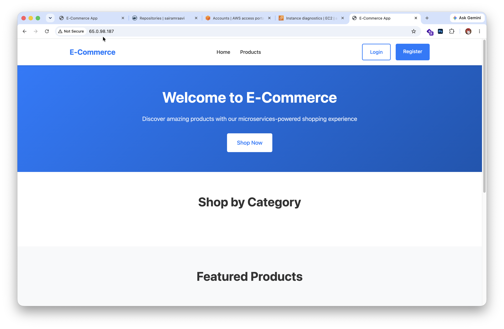
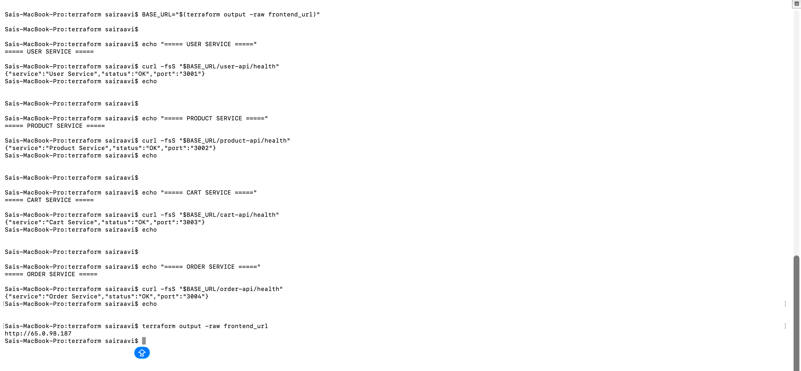
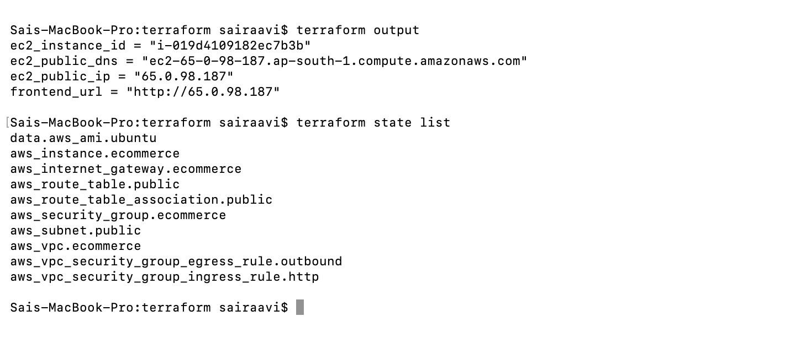
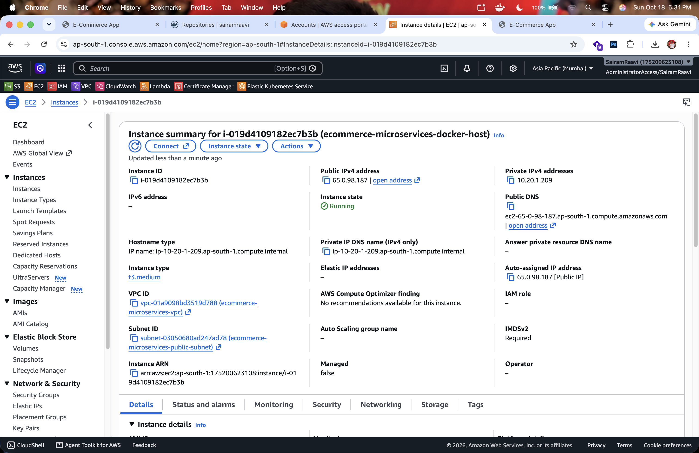
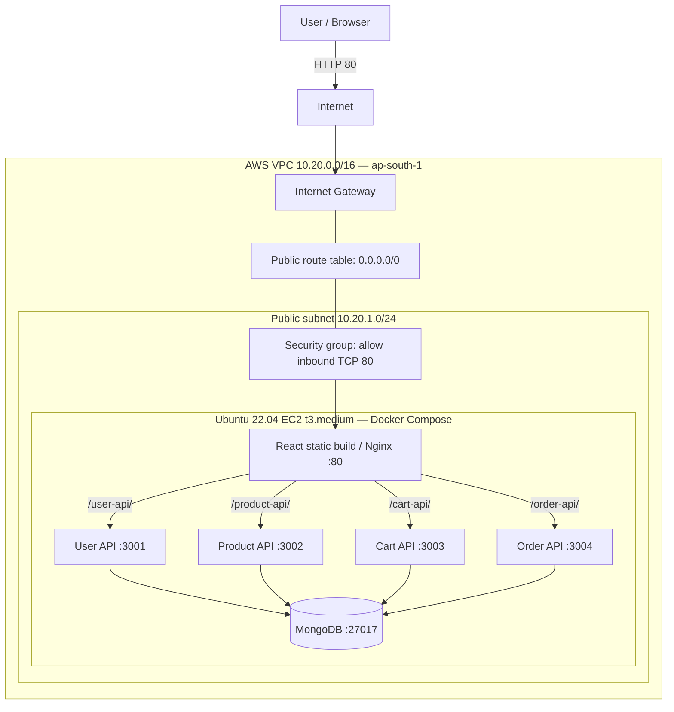
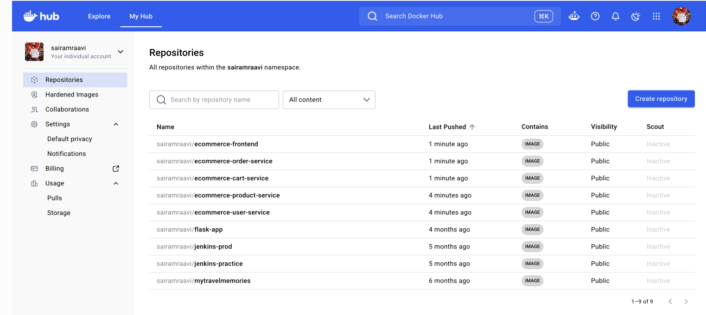

# E-Commerce Microservices on AWS — Terraform & Docker

[](https://aws.amazon.com/ec2/)
[](https://developer.hashicorp.com/terraform)
[](https://www.docker.com/)
[](https://nodejs.org/)

> **Assignment:** Deploy a Multi-Service Node.js E-Commerce Application Using Terraform and Docker · **50 marks**  
> **Implementation repository:** [sairamraavi/ecommerce-microservices-terraform-aws](https://github.com/sairamraavi/ecommerce-microservices-terraform-aws)  
> **Original application:** [AtharvaAI/E-CommerceStore](https://github.com/AtharvaAI/E-CommerceStore) (application source adapted for this DevOps assignment)  
> **Deployment region:** AWS Mumbai (`ap-south-1`) · **Compute:** Ubuntu 22.04 EC2 `t3.medium`

## AWS Deployment — Result

**The e-commerce application was deployed on AWS EC2 with infrastructure provisioned by Terraform and containers installed and launched automatically by EC2 user-data.** The Nginx frontend returned `HTTP/1.1 200 OK`, and **all four backend health endpoints returned `status: OK` through the public AWS endpoint**.

| Verification | Confirmed result |
| --- | --- |
| Terraform infrastructure | 9 managed AWS resources, including VPC, subnet, gateway, routes, security group, EC2 |
| Public frontend | Nginx responded with `HTTP/1.1 200 OK` |
| User API | `GET /user-api/health` → `OK` (3001) |
| Product API | `GET /product-api/health` → `OK` (3002) |
| Cart API | `GET /cart-api/health` → `OK` (3003) |
| Order API | `GET /order-api/health` → `OK` (3004) |
| Image registry | Five public Docker Hub repositories, tagged `v1` |

**Deployment endpoint (at the time of validation):** `http://65.0.98.187`  
**Instance DNS (at the time of validation):** `ec2-65-0-98-187.ap-south-1.compute.amazonaws.com`

> **Note:** The public IPv4 address is temporary and the demo may no longer be accessible after the EC2 environment is replaced or destroyed. Successful HTTP/API responses demonstrate deployment and basic reachability, not complete end-to-end shopping or database-write functionality. This is a demonstration setup, not a production-hardened deployment.

### Evidence: Application live on AWS



*Figure 1 — React/Nginx frontend opened through the AWS EC2 public endpoint.*

### Evidence: All four backend APIs responding on AWS



*Figure 2 — User, Product, Cart and Order services returning healthy API responses via the public Nginx reverse proxy.*

### Evidence: Terraform resources and outputs



*Figure 3 — Terraform outputs (instance ID, DNS, IPv4, frontend URL) and the managed AWS resource list.*

### Evidence: EC2 instance in AWS Console



*Figure 4 — Running EC2 instance hosting the containerized application.*

**[Browse all project screenshots (01–33)](docs/screenshots/)** — full evidence, including repository setup, Dockerfile inspections, local tests, Docker Hub, Terraform plans, deployment and troubleshooting.

---

## AWS Architecture



- Terraform creates the **VPC, public subnet, internet gateway, route table/association, security group and EC2 instance**.
- EC2 **user-data** installs Docker Engine + Compose, pulls images from Docker Hub and starts the stack.
- **Only Nginx port 80** is reachable from the internet. Application ports `3001–3004` and MongoDB port `27017` remain private on the Compose network.
- The deployment is a **single-host lab architecture** for the assignment (not a highly available production design).

## Docker Images and Services

| Service | Docker Hub image | Container port | Public reverse-proxy path |
| --- | --- | ---: | --- |
| User API | [`sairamraavi/ecommerce-user-service:v1`](https://hub.docker.com/r/sairamraavi/ecommerce-user-service) | 3001 | `/user-api/` |
| Product API | [`sairamraavi/ecommerce-product-service:v1`](https://hub.docker.com/r/sairamraavi/ecommerce-product-service) | 3002 | `/product-api/` |
| Cart API | [`sairamraavi/ecommerce-cart-service:v1`](https://hub.docker.com/r/sairamraavi/ecommerce-cart-service) | 3003 | `/cart-api/` |
| Order API | [`sairamraavi/ecommerce-order-service:v1`](https://hub.docker.com/r/sairamraavi/ecommerce-order-service) | 3004 | `/order-api/` |
| Frontend | [`sairamraavi/ecommerce-frontend:v1`](https://hub.docker.com/r/sairamraavi/ecommerce-frontend) | 80 | `/` |
| Database (supporting container) | `mongo:7` | 27017 | Internal only |



*Figure 5 — Public Docker Hub image repositories used by the EC2 deployment.*

## Repository Layout

```text
ecommerce-microservices-terraform-aws/
├── backend/
│   ├── user-service/           # Dockerfile, .dockerignore, server.js, package.json
│   ├── product-service/
│   ├── cart-service/
│   └── order-service/
├── frontend/
│   ├── Dockerfile              # Multi-stage React build -> Nginx
│   ├── nginx.conf              # Routes /user-api, /product-api, etc.
│   ├── .dockerignore
│   ├── public/
│   └── src/
├── terraform/
│   ├── providers.tf            # AWS provider and region
│   ├── variables.tf            # Network and EC2 variables
│   ├── main.tf                 # VPC, subnet, IGW and routing
│   ├── security-groups.tf      # TCP 80 inbound, outbound access
│   ├── ec2.tf                  # AMI lookup and Ubuntu EC2 instance
│   ├── user-data.sh            # Install Docker, pull images, start stack
│   └── outputs.tf              # EC2 details and frontend URL
├── compose.yaml                # Local six-container validation
├── docs/screenshots/           # Deployment screenshots (01–33)
└── README.md
```

## Reproduce the Deployment

### 1. Prerequisites

Install Git, Docker with Compose, Terraform and AWS CLI. Configure AWS authentication (the assignment was executed using AWS IAM Identity Center/SSO) with permissions for the Terraform-managed resources. Use AWS region `ap-south-1`.

```bash
git clone https://github.com/sairamraavi/ecommerce-microservices-terraform-aws.git
cd ecommerce-microservices-terraform-aws

docker --version
docker compose version
terraform version
aws sts get-caller-identity
```

Do not save AWS access keys or session tokens in Git.

### 2. Build the five application images

Four backend services use **Node.js 22** and run `node server.js` with production dependencies. The frontend uses a **multi-stage build**: Node.js compiles React, then Nginx serves the static files and proxies API requests.

```bash
docker build --platform linux/amd64 -t ecommerce-user-service:v1 ./backend/user-service
docker build --platform linux/amd64 -t ecommerce-product-service:v1 ./backend/product-service
docker build --platform linux/amd64 -t ecommerce-cart-service:v1 ./backend/cart-service
docker build --platform linux/amd64 -t ecommerce-order-service:v1 ./backend/order-service
docker build --platform linux/amd64 -t ecommerce-frontend:v1 ./frontend

docker image ls --filter 'reference=ecommerce-*'
```

`linux/amd64` targets the x86-64 architecture used by the EC2 `t3.medium` instance. This assignment's Dockerfiles use `npm install`; for stronger reproducibility in CI/CD, commit dependency lockfiles and use `npm ci`.

### 3. Validate locally with Docker Compose (pre-deployment check)

The local stack uses the five application images plus a MongoDB container. It maps the frontend to **localhost port 8080**; backend ports stay internal.

```bash
docker compose -f compose.yaml config --quiet
docker compose -f compose.yaml up -d
docker compose -f compose.yaml ps -a

curl -fsS http://localhost:8080/user-api/health
curl -fsS http://localhost:8080/product-api/health
curl -fsS http://localhost:8080/cart-api/health
curl -fsS http://localhost:8080/order-api/health
```

Local validation evidence: [running containers](docs/screenshots/14-running-containers.png) · [API responses](docs/screenshots/15-backend-health-checks.png) · [local frontend](docs/screenshots/16-frontend-local.png) · [MongoDB verification](docs/screenshots/17-mongodb-verification.png).

### 4. Tag and push images to Docker Hub

```bash
docker login

for service in user product cart order; do
  docker tag "ecommerce-${service}-service:v1" "sairamraavi/ecommerce-${service}-service:v1"
  docker push "sairamraavi/ecommerce-${service}-service:v1"
done

docker tag ecommerce-frontend:v1 sairamraavi/ecommerce-frontend:v1
docker push sairamraavi/ecommerce-frontend:v1
```

All five repositories must be **public** for unauthenticated `docker compose pull` on EC2. Confirm the pushed image manifests support `linux/amd64`.

### 5. Provision infrastructure with Terraform

```bash
cd terraform

# Renew SSO authentication when necessary:
# aws sso login --profile YOUR_PROFILE_NAME

terraform init
terraform fmt
terraform validate
terraform plan -out=ecommerce.tfplan
terraform apply ecommerce.tfplan
```

Main Terraform configuration:

| File | Resources / behavior |
| --- | --- |
| `providers.tf` | AWS provider in Mumbai and common resource tags |
| `main.tf` | VPC `10.20.0.0/16`, public subnet `10.20.1.0/24`, IGW, public routing |
| `security-groups.tf` | Public ingress TCP `80`; egress for installation and image pulls |
| `ec2.tf` | Latest matching Ubuntu 22.04 AMI, `t3.medium`, encrypted gp3 root storage, public IP, IMDSv2, user-data |
| `user-data.sh` | Installs Docker, creates `/opt/ecommerce/compose.yaml`, pulls Docker Hub images, starts containers |
| `outputs.tf` | Instance ID, public IPv4, public DNS and frontend URL |

**Cloud-init / user-data runs asynchronously.** `terraform apply` can finish before the application has started. Allow time for package installation, image pulls and MongoDB startup.

### 6. Verify the deployment on AWS

```bash
terraform output
terraform state list

BASE_URL="$(terraform output -raw frontend_url)"
curl -I "$BASE_URL"

curl -fsS "$BASE_URL/user-api/health"
curl -fsS "$BASE_URL/product-api/health"
curl -fsS "$BASE_URL/cart-api/health"
curl -fsS "$BASE_URL/order-api/health"
```

**Observed result during assignment:** HTTP `200 OK` from Nginx, and all four health endpoints returned JSON with `"status":"OK"` and their respective ports. The browser rendering and API responses were validated separately.

### 7. Troubleshooting: cloud-init bootstrap failure and recovery

On the initial AWS launch, the frontend was unreachable (`curl: (7) ... port 80`). EC2 booted, but the cloud-init `scripts_user` stage failed. We diagnosed the issue using EC2 system logs and checked the user-data script.

The initial file contained a blank line before the `#!/bin/bash` shebang; it was corrected so `#!` were the first two bytes. Logging was enhanced to send bootstrap output to both the local log and EC2 console:

```bash
#!/bin/bash
set -euxo pipefail
exec > >(tee -a /var/log/ecommerce-bootstrap.log /dev/console) 2>&1
```

Validation and redeployment:

```bash
bash -n user-data.sh
head -c 12 user-data.sh | od -An -tx1
terraform plan
# Review replacement carefully before applying:
terraform apply
```

With `user_data_replace_on_change = true`, Terraform replaced **only the EC2 instance**, leaving the Terraform networking in place. After recovery, the new instance served the frontend successfully and all four backends passed health checks. **Replacing an instance removes data on its deleted root volume; review impact first.**

Troubleshooting evidence: [user-data configuration](docs/screenshots/25-terraform-user-data.png) · [recovery record](docs/screenshots/29-terraform-ec2-recovery.png).

## Evidence Gallery and Screenshot Index

The main README prioritizes **AWS deployment evidence**. The remaining screenshots are retained for traceability, source inspection and build verification.

| Phase | Key screenshots / evidence |
| --- | --- |
| **AWS deployment (primary)** | [26 — Terraform apply](docs/screenshots/26-terraform-apply.png) · [27 — EC2 instance](docs/screenshots/27-aws-ec2-instance.png) · [28 — AWS frontend](docs/screenshots/28-aws-frontend-live.png) · [30 — AWS API checks](docs/screenshots/30-aws-backend-health-checks.png) · [31 — AWS frontend](docs/screenshots/31-aws-frontend-live.png) · [32 — Terraform outputs](docs/screenshots/32-terraform-infrastructure.png) · [33 — Running EC2](docs/screenshots/33-aws-ec2-running.png) |
| **Terraform and networking** | [20 — AWS preparation](docs/screenshots/20-aws-preparation.png) · [21 — Terraform initialization](docs/screenshots/21-terraform-initialization.png) · [22 — VPC plan](docs/screenshots/22-terraform-vpc-plan.png) · [23 — Security group](docs/screenshots/23-terraform-security-group.png) · [24 — EC2 configuration](docs/screenshots/24-terraform-ec2-configuration.png) · [25 — user-data](docs/screenshots/25-terraform-user-data.png) · [29 — recovery](docs/screenshots/29-terraform-ec2-recovery.png) |
| **Docker and registry** | [12 — Docker images](docs/screenshots/12-docker-images-built.png) · [13 — Docker Compose configuration](docs/screenshots/13-docker-compose-configuration.png) · [14 — running containers](docs/screenshots/14-running-containers.png) · [15 — backend health](docs/screenshots/15-backend-health-checks.png) · [16 — local frontend](docs/screenshots/16-frontend-local.png) · [17 — MongoDB](docs/screenshots/17-mongodb-verification.png) · [18 — image tags](docs/screenshots/18-dockerhub-image-tagging.png) · [19 — Docker Hub repositories](docs/screenshots/19-dockerhub-repositories.png) |
| **Initial application inspection** | [01 — repository structure](docs/screenshots/01-github-repository-structure.png) · [02 — tool versions](docs/screenshots/02-development-prerequisites.png) · [03 — backend services](docs/screenshots/03-backend-services.png) · [04 — user service](docs/screenshots/04-user-service-inspection.png) · [05 — image build](docs/screenshots/05-user-service-docker-build.png) · [06 — product service](docs/screenshots/06-product-service-inspection.png) · [07 — cart service](docs/screenshots/07-cart-service-inspection.png) · [08 — order service](docs/screenshots/08-order-service-inspection.png) · [09 — frontend inspection](docs/screenshots/09-frontend-inspection.png) · [10 — frontend Dockerfile](docs/screenshots/10-frontend-dockerfile.png) · [11 — Nginx](docs/screenshots/11-nginx-reverse-proxy.png) |

**[Open the complete `docs/screenshots/` folder on GitHub](https://github.com/sairamraavi/ecommerce-microservices-terraform-aws/tree/main/docs/screenshots)**. If documentation has not yet been merged into `main`, browse the same folder on the active feature branch.

## Security Notes and Limitations

- This was a time-boxed assignment deployment. The demo uses **HTTP**, not HTTPS.
- Public inbound access is limited to **TCP 80**; Docker backend ports and MongoDB are not published to the internet.
- MongoDB is an internal demonstration container; use authentication, backups and appropriate secret management for production.
- Local build steps use `npm install` without lockfile pinning; production pipelines should use committed lockfiles and `npm ci`.
- Container health endpoints are smoke checks, not comprehensive functional or security tests.
- For production, add TLS, database hardening, least-privilege IAM, monitoring, scalable service orchestration and more resilient infrastructure.

## Cleanup — Prevent AWS Charges

After capturing all evidence and completing evaluation, destroy the disposable assignment environment:

```bash
cd terraform
terraform destroy
```

Review the destroy plan before approving. This will remove the Terraform-managed infrastructure, including the EC2 instance and its instance-attached data. The old public IP will stop serving the application. Do **not** commit `.tfstate`, `.tfvars` with secrets, saved `.tfplan` files or AWS credentials.

---

**Prepared as a practical DevOps assignment demonstrating Docker image creation, Docker Hub publishing, Terraform Infrastructure as Code, EC2 bootstrap automation, cloud deployment verification and troubleshooting.**
